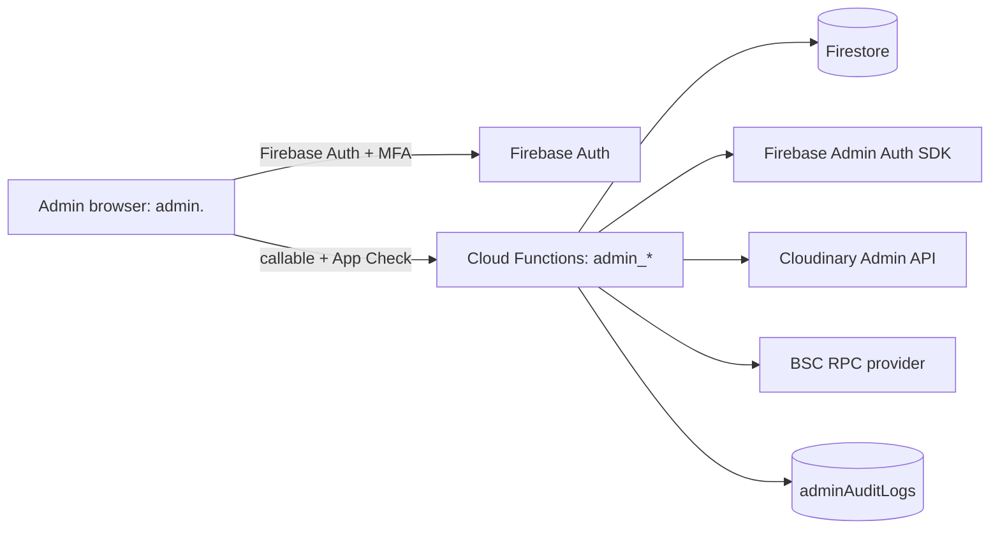

# EliteChat Admin Panel

Version 0.1 (draft) · Last updated 2026-10-13

Design for the internal admin panel, written for the Firebase-only backend (Firestore, Cloud Functions, Firebase Hosting, Cloudinary, BEP-20 on BNB Smart Chain). Read it with [security.md](security.md) and [architecture.md](architecture.md). Items marked **[VERIFY]** depend on current Firebase/Google Cloud behavior or pricing.

## 1. Purpose and principles

The admin panel lets a small trusted team moderate content, support users, manage subscriptions and plans, and operate the app. It is also the most dangerous part of the system: a compromised admin account can affect every user.

1. **Least privilege.** Five roles, each with the minimum permissions (section 4).
2. **Server-enforced.** The UI hides buttons for convenience; every action is authorized again in a Cloud Function.
3. **Everything is audited.** Every admin action and every sensitive read writes an append-only audit record.
4. **Privacy by design.** Admins cannot browse private conversations. They see only evidence attached to a report (section 7).
5. **Two people for dangerous changes.** High-risk actions need a second approver (section 9).
6. **Separate from the user app.** Own site, own origin, own hardening.

## 2. Scope

**In scope for v1:** admin sign-in with MFA, role management, user lookup and suspension/ban, report queue and moderation cases, group/channel moderation, payments and subscription tools, plan management, app config, audit log viewer, dashboard.

**Not in v1:** reading private messages, impersonating users, editing user messages, bulk data export of personal data, automated moderation/ML.

## 3. Architecture



- **Hosting:** a second Firebase Hosting site (multi-site) such as `admin.elitechat.app` (placeholder), separate from the user app.
- **Client:** a separate web project, `admin_panel/`. Recommended: Flutter Web with the same GetX conventions, so the team reuses skills and models. A React/Vite app is a valid alternative; decide once.
- **Access path:** the panel talks to **callable Cloud Functions** (`admin_*`). It does not read or write sensitive collections directly. Non-sensitive live data (open report count, daily stats) may be read directly under Security Rules that check the admin claim.
- **Why callables:** Firebase verifies the caller's ID token, App Check can be enforced, and each function can authorize, validate, rate limit, and write an audit entry in one place.

```json
{
  "hosting": [
    { "target": "app",   "public": "build/web", "rewrites": [{ "source": "**", "destination": "/index.html" }] },
    {
      "target": "admin",
      "public": "admin_panel/build/web",
      "rewrites": [{ "source": "**", "destination": "/index.html" }],
      "headers": [{
        "source": "**",
        "headers": [
          { "key": "X-Frame-Options", "value": "DENY" },
          { "key": "X-Content-Type-Options", "value": "nosniff" },
          { "key": "Referrer-Policy", "value": "no-referrer" },
          { "key": "Cache-Control", "value": "no-store" }
        ]
      }]
    }
  ]
}
```

Add a strict Content-Security-Policy to the admin site after testing (Flutter Web needs specific allowances).

## 4. Authentication and roles

### Sign-in

- Admins use **email + password or Google SSO restricted to your organization, plus mandatory MFA (TOTP)**. They never sign in with a wallet.
- Admin accounts are created only by a superadmin. Public sign-up must be blocked for the admin site. MFA and sign-up blocking functions generally need the Identity Platform upgrade of Firebase Auth. **[VERIFY availability and pricing]**
- Session limits: idle timeout 15 minutes, absolute lifetime 8 hours, re-authentication (fresh sign-in) before destructive or high-risk actions.

### Roles

| Role | Intended for | Summary |
| --- | --- | --- |
| `superadmin` | 1–2 owners | Everything, including managing admins and approving high-risk changes |
| `admin` | Operations lead | Users, content, payments, plans (proposals), config; cannot manage admins |
| `moderator` | Trust and safety | Reports, content removal, suspend/ban, no payment or plan access |
| `support` | Customer support | Read user and subscription status; limited actions (re-check payment, resend verification) |
| `analyst` | Read-only | Dashboard and aggregate stats only; no personal data |

### Permission matrix

| Capability | super | admin | mod | support | analyst |
| --- | :---: | :---: | :---: | :---: | :---: |
| View dashboard/aggregates | ✔ | ✔ | ✔ | ✔ | ✔ |
| Search users, view profile | ✔ | ✔ | ✔ | ✔ | ✘ |
| Reveal linked wallet address | ✔ | ✔ | ✔ | ✘ | ✘ |
| Suspend / unsuspend user | ✔ | ✔ | ✔ | ✘ | ✘ |
| Ban user (permanent) | ✔ | ✔ | ✔ (needs approval) | ✘ | ✘ |
| Revoke user sessions | ✔ | ✔ | ✔ | ✘ | ✘ |
| Report queue and cases | ✔ | ✔ | ✔ | view | ✘ |
| Remove post / message evidence | ✔ | ✔ | ✔ | ✘ | ✘ |
| Suspend group / channel | ✔ | ✔ | ✔ | ✘ | ✘ |
| View payments and subscriptions | ✔ | ✔ | ✘ | ✔ | ✘ |
| Re-check a payment | ✔ | ✔ | ✘ | ✔ | ✘ |
| Grant / revoke subscription manually | ✔ | ✔ (needs approval above limit) | ✘ | ✘ | ✘ |
| Propose plan changes | ✔ | ✔ | ✘ | ✘ | ✘ |
| Approve plan / receiver-address changes | ✔ | ✘ | ✘ | ✘ | ✘ |
| Edit app config / feature flags | ✔ | ✔ | ✘ | ✘ | ✘ |
| Send announcements | ✔ | ✔ (needs approval) | ✘ | ✘ | ✘ |
| Manage admin accounts and roles | ✔ | ✘ | ✘ | ✘ | ✘ |
| View audit log | ✔ | ✔ | own actions | own actions | ✘ |

### How roles are stored and checked

- Source of truth: `adminUsers/{uid}` with `role`, `active`, `createdBy`, `createdAt`, `mfaEnrolled`.
- A copy is placed in a **custom claim** (`adminRole`) for fast checks. Claims are small (1,000 byte limit) and stale until the token refreshes (up to about an hour).
- **Every callable re-reads `adminUsers/{uid}`** and requires `active == true`, so disabling an admin takes effect immediately, regardless of token age. Disabling also calls `revokeRefreshTokens` and disables the Firebase Auth user.
- Role changes happen only through `admin_setRole` (superadmin, approval required, audited). Bootstrap the first superadmin with a one-time local script using a service account that is not stored in the repository; document it as a break-glass procedure.

## 5. Data model additions (Firestore)

```
adminUsers/{uid}                 role, active, createdBy, createdAt, lastLoginAt
adminAuditLogs/{id}              append-only (see section 8)
adminApprovals/{id}              pending high-risk requests (section 9)
moderationCases/{caseId}         status, type, targetType, targetId, reporterIds[], evidence[], assignedTo, resolution
reports/{id}                     user-submitted (already in the main model); linked to a case by a trigger
bannedUsers/{uid}                reason, bannedAt, bannedBy, until?   (server-only; checked by Rules)
appConfig/current                maintenanceMode, minAppVersion, allowedTokens, featureFlags
stats/daily_{yyyymmdd}           precomputed aggregates for the dashboard
announcements/{id}               draft | pending_approval | sent
```

User documents gain moderation fields written only by functions: `status` (`active` | `suspended` | `banned`), `suspendedUntil`, `moderationNote` (internal; never readable by the user, so keep it in a server-only subcollection `users/{uid}/private/moderation` if the user doc is readable by others).

All admin collections are server-only under Security Rules:

```
match /adminUsers/{id}        { allow read: if request.auth.uid == id; allow write: if false; }
match /adminAuditLogs/{id}    { allow read, write: if false; }
match /adminApprovals/{id}    { allow read, write: if false; }
match /moderationCases/{id}   { allow read, write: if false; }
match /bannedUsers/{id}       { allow read, write: if false; }
match /appConfig/{id}         { allow read: if request.auth != null; allow write: if false; }  // client-safe fields only
```

## 6. Modules and screens

```
Sidebar:  Dashboard · Users · Reports · Content · Payments · Plans · Announcements · Config · Admins · Audit log
```

### 6.1 Dashboard

Widgets: new users, daily active users, messages sent, open reports and oldest open age, payments confirmed/pending/rejected, active subscriptions, function error rate.

- Do not count whole collections on every page load. A scheduled function writes `stats/daily_*` documents; the dashboard reads those.
- Heavy analytics (retention, funnels): use Firebase Analytics with BigQuery export. **[VERIFY setup and cost]**
- Do not use per-message counters on a single document (write contention); use sharded counters or the analytics export.

### 6.2 Users

- **Search:** by exact UID, handle prefix (Firestore range query on `handle`), or wallet address. Wallet lookup is a direct document get on `wallets/{chain_address}`. Free-text search is not available in Firestore; add a search service later if needed.
- **User detail:** profile fields, status, created date, linked wallet count, subscription state, report history (as target and as reporter), moderation notes, active session count.
- **Wallet addresses are masked by default.** Revealing one requires a click and writes a `wallet_revealed` audit entry (the function returns the address only after logging).
- **Actions:** suspend (duration), unsuspend, ban, revoke sessions, add internal note. Each requires a reason (minimum length) and writes an audit record.
- No message content, no impersonation, no editing of user profile text (except removing an abusive avatar/bio through a logged "clear field" action).

### 6.3 Reports and moderation cases

Workflow:

```
user submits report → trigger creates case + snapshots evidence
  → open → in_review (assigned) → actioned | dismissed | escalated
  → (optional) user appeal → reopened and assigned to a different admin
```

- **Evidence snapshot:** when a report is filed about a message, a function copies the reported message(s) and a few messages of context (limited, and only those the reporter could see) into the case. This preserves evidence if the sender deletes it, and it keeps admins from reading the wider conversation.
- **Actions from a case:** dismiss, warn user, remove content (soft-delete post/message), suspend, ban (approval may be required), escalate to legal/senior.
- Queue: filters by type, severity, status, age, assignee; sort by oldest; cursor pagination; keyboard shortcuts for triage.
- Define response-time targets (for example severe within hours) and track them on the dashboard.
- Legal/safety escalation, including child-safety reporting duties, must be defined with counsel before launch. The panel only provides the escalation status and evidence export; the process lives outside it.

### 6.4 Content (groups and channels)

- Browse channels and groups by handle or ID: metadata only (title, description, member count, owner, status).
- Actions: suspend/restore a channel or group, remove a channel post, transfer or remove ownership (approval), mark channels as verified or featured.
- Group chat message bodies are not browsable; moderation of group messages happens through reports.

### 6.5 Payments and subscriptions

- Payment list: filter by status, plan, date, user; columns for chain, tx hash (link to BscScan), amount in token units, status, verified time.
- **Re-check payment:** calls the same verification logic as `verifyPayment` for an existing tx; never edits amounts manually.
- **Manual grant/revoke subscription:** requires a reason, caps the duration (for example up to 30 days without approval), and writes `source: "admin_grant"` so it is distinguishable from paid access. Revocation of a paid subscription needs approval.
- Refunds are off-chain actions by finance; the panel records a refund note and revokes entitlement but does not move funds.
- Reconciliation view: confirmed payments vs. receiver wallet incoming transfers (read-only, via RPC) to detect discrepancies.

### 6.6 Plans

- Create/edit plans: name, chain (56 or 97), token contract (from allowlist), decimals, price in base units (shown in human units), receiver address, duration, active flag.
- **Receiver address, token contract, and price changes are high-risk** (section 9): second approver, a cooldown (for example 24 hours before activation), alert to all superadmins, and a visible change history. Never edit a plan in place that has active subscriptions; create a new plan version.

### 6.7 Announcements

- Compose, target (all users, platform, or channel subscribers), preview, and schedule.
- Requires approval; rate-limited (for example one broadcast per day); sent through FCM topics; logged. Content is plain text with an optional deep link from an allowlist of routes.

### 6.8 Config

- Maintenance mode, minimum supported app version (force update), token allowlist, feature flags, limits (group size, upload size). Stored in `appConfig/current` (client-safe fields only) with a version number and change history. Changes are audited; maintenance-mode and allowlist changes require approval.

### 6.9 Admins

- Invite/disable admins, set role, view last login and MFA status, force sign-out. Superadmin only; changes need a second superadmin where more than one exists.

### 6.10 Audit log

- Searchable, filterable, read-only. Export to CSV for superadmins only (and that export is itself audited).

## 7. Privacy rules for admin access

- Admins never read private DM or group message streams. Reports carry their own evidence snapshot.
- If end-to-end encryption ships (Phase 5), the server cannot read content at all; moderation then relies on user-submitted decrypted evidence. Design the report flow now to support this.
- Show the minimum data needed for the task; mask wallets, hide timestamps of private activity that is not relevant.
- Sensitive reads (reveal wallet, open a case with evidence) are logged with the reason or case ID.
- Retention: keep case evidence for a defined period, then delete; keep audit logs per policy (see section 8).
- Admin staff must be bound by confidentiality and complete security and privacy training.

## 8. Audit logging

Each record in `adminAuditLogs` is written only by Cloud Functions:

```json
{
  "actorUid": "…",
  "actorRole": "moderator",
  "action": "user.suspend",
  "targetType": "user",
  "targetId": "…",
  "reason": "Harassment, case #1042",
  "caseId": "…",
  "before": { "status": "active" },
  "after":  { "status": "suspended", "until": "2026-10-20T00:00:00Z" },
  "requestId": "…",
  "ip": "…",
  "userAgent": "…",
  "createdAt": "<server timestamp>"
}
```

- **Append-only:** Security Rules deny all client access; functions never update or delete entries. For tamper resistance, also stream audit entries to Cloud Logging or BigQuery (log sink) with restricted write access. **[VERIFY setup]**
- Keep `before`/`after` limited to what is needed; never store tokens, signatures, or message bodies.
- Write the audit entry in the **same Firestore batch/transaction** as the state change so one cannot occur without the other.
- Alerts (Cloud Monitoring or a notification function) for: admin login from a new device/IP, role changes, plan receiver changes, maintenance-mode changes, bulk actions, repeated permission-denied errors, and any `break-glass` use.

## 9. Two-person approval (high-risk actions)

Actions requiring approval by a second, different superadmin/admin (as listed in the matrix):

| Action | Approver | Extra control |
| --- | --- | --- |
| Change plan receiver address, token, or price | Superadmin | 24 h cooldown, alert |
| Grant subscription above the cap | Superadmin | Reason and cap |
| Permanent ban by a moderator | Admin/Superadmin | Case must exist |
| Send announcement | Admin/Superadmin | Preview |
| Change admin role | Another superadmin | Re-authentication |
| Enable maintenance mode / change token allowlist | Superadmin | Alert |

Flow: requester creates `adminApprovals/{id}` through `admin_requestApproval` with the intended payload; an approver reviews the exact payload and calls `admin_approve`; the function re-validates the payload, checks requester ≠ approver, applies it, and writes audit entries for both steps. Requests expire after a set time. If the team has only one superadmin, document this gap and the compensating control (alerts to an external channel plus periodic review).

## 10. Cloud Functions API

All are `onCall` with `enforceAppCheck: true`, `maxInstances` set, input validation, role check, active-admin check, MFA check, reason required for mutations, and an audit entry.

| Function | Roles | Notes |
| --- | --- | --- |
| `admin_searchUsers` | super, admin, mod, support | Rate limited; returns minimal fields |
| `admin_getUser` | super, admin, mod, support | Wallets masked |
| `admin_revealWallet` | super, admin, mod | Logs before returning |
| `admin_suspendUser` / `admin_unsuspendUser` | super, admin, mod | Updates status, bannedUsers, sessions |
| `admin_banUser` | super, admin, mod (approval) | Permanent |
| `admin_revokeSessions` | super, admin, mod | `revokeRefreshTokens` |
| `admin_listCases` / `admin_getCase` / `admin_resolveCase` | super, admin, mod (support: read) | Cursor pagination |
| `admin_removeContent` | super, admin, mod | Soft-delete, audited |
| `admin_setGroupStatus` / `admin_setChannelStatus` | super, admin, mod | |
| `admin_listPayments` / `admin_recheckPayment` | super, admin, support | Reuses payment verifier |
| `admin_grantSubscription` / `admin_revokeSubscription` | super, admin | Caps and approvals |
| `admin_upsertPlan` | super, admin (propose) | Approval for high-risk fields |
| `admin_setConfig` | super, admin | Versioned |
| `admin_sendAnnouncement` | super, admin (approval) | Rate limited |
| `admin_requestApproval` / `admin_approve` / `admin_reject` | per action | Requester ≠ approver |
| `admin_setRole` / `admin_inviteAdmin` / `admin_disableAdmin` | super | Approval, re-auth |
| `admin_listAudit` | super, admin; own for mod/support | Filters |

### Skeleton

```ts
import { onCall, HttpsError, CallableRequest } from "firebase-functions/v2/https";
import { getFirestore, FieldValue } from "firebase-admin/firestore";
import { getAuth } from "firebase-admin/auth";

type Role = "superadmin" | "admin" | "moderator" | "support" | "analyst";

async function requireAdmin(req: CallableRequest, allowed: Role[]) {
  const uid = req.auth?.uid;
  if (!uid) throw new HttpsError("unauthenticated", "Sign in required.");

  // MFA must have been used for this session. [VERIFY claim name in current docs]
  if (!req.auth?.token.firebase?.sign_in_second_factor) {
    throw new HttpsError("permission-denied", "MFA required.");
  }

  // Source of truth, so disabling an admin takes effect immediately.
  const snap = await getFirestore().doc(`adminUsers/${uid}`).get();
  const role = snap.data()?.role as Role | undefined;
  if (!snap.exists || snap.data()?.active !== true || !role || !allowed.includes(role)) {
    throw new HttpsError("permission-denied", "Not allowed.");
  }
  return { uid, role, ip: req.rawRequest.ip };
}

export const admin_suspendUser = onCall(
  { enforceAppCheck: true, maxInstances: 5 },
  async (req) => {
    const actor = await requireAdmin(req, ["superadmin", "admin", "moderator"]);

    const { targetUid, reason, hours } = req.data ?? {};
    if (typeof targetUid !== "string" || targetUid.length < 6 || targetUid.length > 128) {
      throw new HttpsError("invalid-argument", "Invalid user.");
    }
    if (typeof reason !== "string" || reason.trim().length < 10 || reason.length > 500) {
      throw new HttpsError("invalid-argument", "A reason (10-500 chars) is required.");
    }
    if (!Number.isInteger(hours) || hours < 1 || hours > 24 * 90) {
      throw new HttpsError("invalid-argument", "Invalid duration.");
    }

    const db = getFirestore();
    const until = new Date(Date.now() + hours * 3600 * 1000);
    const userRef = db.doc(`users/${targetUid}`);

    await db.runTransaction(async (tx) => {
      const user = await tx.get(userRef);
      if (!user.exists) throw new HttpsError("not-found", "User not found.");
      const before = { status: user.data()?.status ?? "active" };

      tx.update(userRef, { status: "suspended", suspendedUntil: until });
      tx.set(db.doc(`bannedUsers/${targetUid}`), {
        reason, bannedAt: FieldValue.serverTimestamp(), bannedBy: actor.uid, until,
      });
      tx.set(db.collection("adminAuditLogs").doc(), {
        actorUid: actor.uid, actorRole: actor.role, action: "user.suspend",
        targetType: "user", targetId: targetUid, reason,
        before, after: { status: "suspended", until: until.toISOString() },
        ip: actor.ip ?? null, createdAt: FieldValue.serverTimestamp(),
      });
    });

    // Auth calls cannot join the Firestore transaction; a reconciliation job
    // should detect and repair any suspended user whose sessions were not revoked.
    await getAuth().revokeRefreshTokens(targetUid);
    return { ok: true };
  }
);
```

### Enforcing bans quickly

- `revokeRefreshTokens` stops new ID tokens, but an already-issued token stays valid until it expires (about an hour).
- For immediate effect on Firestore, Security Rules can deny users that exist in `bannedUsers` (`!exists(/databases/$(database)/documents/bannedUsers/$(request.auth.uid))`). This adds a billed read per rule evaluation, so apply it only to high-risk paths such as creating messages and posts.
- Callable functions that act on behalf of users should call `verifyIdToken(token, true)` (check revoked) where they handle tokens directly, and check ban status.

## 11. Security controls specific to the panel

- MFA mandatory; admin site and callables protected by App Check (reCAPTCHA Enterprise on Web). **[VERIFY]**
- No third-party scripts on the admin site; strict CSP, `frame-ancestors 'none'`, `no-store` caching.
- Optional network layer: restrict by IP/VPN or an access proxy in front of the admin domain. Firebase Hosting has no built-in IP allowlist, so this needs an extra service. **[VERIFY options]**
- Rate limit every callable (transactional Firestore counters keyed by admin UID) and cap `maxInstances`.
- Secrets (Cloudinary secret, RPC key, service accounts) only in Secret Manager; the admin client holds none.
- Admin Cloud Functions run with a dedicated service account that has only the roles it needs.
- Use short-lived deployment credentials in CI (Workload Identity Federation); no long-lived service-account keys in GitHub. **[VERIFY setup]**
- Quarterly access review: remove unused admins, check roles, review audit anomalies.
- Admin devices: managed laptops with disk encryption and screen lock; no admin work on shared or public machines.
- Never log reasons, notes, or evidence into general application logs; keep them in their intended collections.

## 12. UI and UX guidelines

- Desktop-first, responsive down to tablet. Dark and light themes using the tokens in [design.md](design.md); a distinct accent or banner makes the admin site visually unmistakable from the user app, and a prominent "PROD" or "DEV" environment badge prevents mistakes.
- Dense tables with filters, saved views, cursor pagination, and CSV export for permitted roles only.
- Detail drawers keep context while triaging.
- **Destructive actions:** confirmation dialog stating the target and consequence, a required reason field, and re-authentication for the highest-risk actions.
- Show the actor's role and "what you can do" so unavailable actions are hidden or disabled with an explanation.
- Clear empty, loading, and error states; never show raw error objects.
- Accessibility: keyboard navigation, focus management in dialogs, labels on icon buttons, sufficient contrast.
- English first; Bengali labels optional for the support team.

Suggested structure (Flutter Web, same conventions as the main app):

```
admin_panel/lib/
├── main.dart
├── core/            # theme, role_gate, confirm_reason_dialog, data_table, error_view
├── data/
│   ├── models/      # admin_user, case, payment, plan, audit_entry
│   └── repositories/# thin wrappers over httpsCallable('admin_*')
├── services/        # firebase_service, session_guard (idle timeout), reauth_service
└── modules/
    ├── dashboard/ users/ reports/ content/ payments/ plans/
    └── announcements/ config/ admins/ audit/
```

## 13. Testing

- **Emulator tests for every callable:** unauthenticated, wrong role, inactive admin, missing MFA claim, missing/short reason, invalid input, success path writes an audit entry, and approval flow enforces requester ≠ approver.
- **Rules tests:** clients (including admins) cannot read or write `adminAuditLogs`, `adminApprovals`, `moderationCases`, `bannedUsers`, `adminUsers` of others.
- **Abuse cases:** role change attempt by a moderator; replaying an approval; approving own request; editing a plan receiver without approval; revealing a wallet without a log entry.
- **Reconciliation job test:** suspended user with live sessions is repaired.
- Manual walkthrough of each role on a staging project before launch.

## 14. Delivery plan

| Step | Alongside app phase | Deliverables |
| --- | --- | --- |
| A. Foundation | Phase 1–2 | Admin site, sign-in + MFA, `adminUsers`, roles, audit log, `admin_setRole`, bootstrap script |
| B. Trust and safety | Phase 3 | Reports → cases with evidence snapshots, user search/detail, suspend/ban/revoke, ban enforcement |
| C. Community | Phase 4 | Group/channel moderation, content removal, announcements (with approvals) |
| D. Money | Phase 6 | Payments view, re-check, manual grant/revoke, plans with approvals, reconciliation |
| E. Operations | Throughout | Dashboard stats, config and feature flags, alerts, access review process |

**Minimum before public launch:** admin sign-in with MFA, roles, audit log, user lookup, suspend/ban, report queue with evidence, payments view, and alerts. Do not launch messaging features to the public without working moderation tools.

## 15. Launch checklist

- [ ] MFA enforced for all admins; sign-up blocked on the admin site
- [ ] Every callable checks role, active status, and MFA, and writes an audit entry
- [ ] Rules deny all client access to admin collections (tested)
- [ ] App Check enforced on admin callables and Firestore
- [ ] Two-person approval live for plan, role, ban, and announcement changes
- [ ] Wallet masking and reveal logging working
- [ ] Evidence-snapshot report flow tested; admins cannot browse private chats
- [ ] Audit log streamed to a restricted log sink; alerts configured
- [ ] Break-glass bootstrap procedure documented and secured
- [ ] Moderation policy, appeal process, and legal escalation path approved by counsel
- [ ] Admin staff trained; access review scheduled
- [ ] Penetration test includes the admin panel

## 16. Open decisions

1. Identity Platform upgrade for MFA and sign-up blocking (cost and availability).
2. Admin front end: Flutter Web or React.
3. Team size and whether two superadmins are available for approvals.
4. Network restriction for the admin domain (VPN, access proxy, or none).
5. Moderation SLAs, appeal policy, and legal escalation procedure per market.
6. Analytics approach: precomputed stats only, or BigQuery export.
