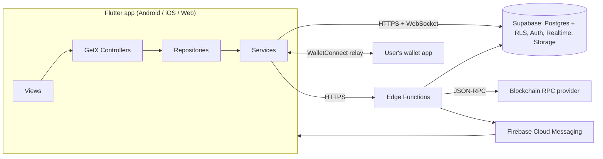

# EliteChat Architecture

Version 0.1 (draft) · Last updated 2026-10-13

## 1. Goals and constraints

**Goals**

- One Flutter codebase for Android, iOS, and Web.
- Feature-first modules that can ship incrementally (Auth → Chats → Groups/Channels → Subscriptions).
- Security enforced at the data layer (RLS), not in the UI.
- Testable layers: controllers testable with fake repositories; repositories testable against a local Supabase.

**Constraints**

- Small team; prefer managed services (Supabase, FCM) over custom infrastructure.
- Wallet-based identity: users have no password; the wallet is the credential.
- Web is a first-class target, so every package choice must be checked for Web support.

## 2. System context



## 3. Technology choices

| Area | Choice | Why | Watch out for |
| --- | --- | --- | --- |
| UI | Flutter | One codebase, three platforms | Web bundle size, Web plugin gaps |
| State/DI/routing | GetX | Fast to build, one package for three jobs | Easy to misuse (global `Get.find`, leaked controllers); follow section 5 |
| Backend | Supabase | Postgres + RLS gives real authorization; Realtime and Storage included | Realtime and RLS performance need indexes and testing |
| Wallet | WalletConnect/Reown-compatible | Standard wallet connection | **[VERIFY]** Flutter package support on Web and current maintenance state |
| Push | FCM | Cross-platform | Web needs a service worker; payload must not leak content |
| Server logic | Supabase Edge Functions (Deno/TypeScript) | Keeps secrets and chain verification off the client | Cold starts, execution limits |

## 4. Layered architecture

```
View  →  Controller  →  Repository  →  Service / Supabase SDK  →  Backend
```

| Layer | Responsibility | May import | Must not |
| --- | --- | --- | --- |
| `views/` | Render state, forward user intent | controllers, `core/widgets`, `core/theme` | Contain business logic, call repositories |
| `controllers/` | UI state (`Rx`), validation, orchestration, navigation | repositories (interfaces), models, `core` | Use `BuildContext`, call Supabase, send blockchain transactions |
| `repositories/` | Data access, mapping JSON ↔ models, error translation | services, providers, models | Hold UI state, show dialogs |
| `services/` | Wrap SDKs (Supabase, wallet, FCM, encryption, logging) | packages, `core` | Know about screens |
| `models/` | Typed immutable data, JSON (de)serialization | nothing app-specific | Contain side effects |
| `core/` | Theme, utils, widgets, errors, config | Flutter, small utilities | Depend on feature modules |

Repositories are defined as an abstract interface plus a Supabase implementation, so controllers can be tested with fakes:

```
data/repositories/chat_repository.dart             // abstract interface
data/repositories/supabase_chat_repository.dart    // implementation
```

## 5. GetX conventions

### Dependency injection

- **App-lifetime singletons** (Supabase service, auth/session, wallet service, notification service, repositories) are registered once in `InitialBinding` using `Get.put(..., permanent: true)`.
- **Screen controllers** are registered in the module's `Binding` via `Get.lazyPut` and are disposed automatically when the route is removed.
- Controllers receive dependencies through constructors (`Get.find` appears only in bindings), so tests can construct them directly.

```dart
class ConversationBinding extends Bindings {
  @override
  void dependencies() {
    Get.lazyPut<ConversationController>(
      () => ConversationController(
        Get.find<ChatRepository>(),
        Get.parameters['id']!,
      ),
    );
  }
}
```

### Controllers

- State is `Rx` fields (`.obs`, `RxnString`); expose read-only getters where practical.
- Start work in `onInit`/`onReady`; **cancel every `StreamSubscription`, `Timer`, and worker in `onClose`**.
- Never hold `BuildContext`. Navigation uses named routes; dialogs and snackbars go through a small `UiService` wrapper.
- One controller per screen concern. Split large screens (for example `ChatListController` vs `ConversationController`).

### Views

- Extend `GetView<T>`; wrap only the smallest widget that needs reactivity in `Obx`.
- Views contain no `try/catch`, no repository calls, and no navigation decisions beyond calling controller methods.

### Routing

- Named routes in `app_routes.dart`; `app_pages.dart` pairs each route with its view and binding.
- `route_guards.dart` implements `GetMiddleware` to redirect unauthenticated users to `/wallet-login`. This is a UX convenience only; the real gate is RLS.
- Path parameters (for example `/conversation/:id`) are validated as UUIDs in the controller before use.

## 6. Error handling

Repositories return a `Result` rather than throwing, so every call site must handle failure.

```dart
sealed class Result<T> {
  const Result();
}

final class Ok<T> extends Result<T> {
  const Ok(this.value);
  final T value;
}

final class Err<T> extends Result<T> {
  const Err(this.error);
  final AppException error;
}
```

`AppException` has a stable `code` (for logic and analytics), a user-safe `message` key (for localization), and an optional private `cause` (for logs only, never shown to users).

## 7. Example: messages end to end

**Repository**

```dart
abstract interface class ChatRepository {
  Future<Result<List<MessageModel>>> fetchMessages({
    required String conversationId,
    DateTime? before,
    int limit = 30,
  });
  Future<Result<MessageModel>> sendMessage(NewMessage draft);
  Stream<MessageModel> watchMessages(String conversationId);
}

class SupabaseChatRepository implements ChatRepository {
  SupabaseChatRepository(this._client);
  final SupabaseClient _client;

  @override
  Future<Result<List<MessageModel>>> fetchMessages({
    required String conversationId,
    DateTime? before,
    int limit = 30,
  }) async {
    try {
      var query = _client
          .from('messages')
          .select()
          .eq('conversation_id', conversationId);
      if (before != null) {
        query = query.lt('created_at', before.toUtc().toIso8601String());
      }
      final rows = await query.order('created_at', ascending: false).limit(limit);
      return Ok(rows.map(MessageModel.fromJson).toList());
    } on PostgrestException catch (e) {
      return Err(AppException.fromPostgrest(e));
    }
  }
  // sendMessage / watchMessages omitted
}
```

> Pagination by `created_at` alone can skip or repeat rows that share a timestamp. Production code should page on the composite key `(created_at, id)`, matching the index in [database.md](database.md).

**Controller**

```dart
class ConversationController extends GetxController {
  ConversationController(this._chat, this.conversationId);

  final ChatRepository _chat;
  final String conversationId;

  final messages = <MessageModel>[].obs;
  final isLoading = false.obs;
  final errorKey = RxnString();
  StreamSubscription<MessageModel>? _sub;

  @override
  void onInit() {
    super.onInit();
    loadInitial();
    _sub = _chat.watchMessages(conversationId).listen(_onIncoming);
  }

  Future<void> loadInitial() async {
    isLoading.value = true;
    final result = await _chat.fetchMessages(conversationId: conversationId);
    switch (result) {
      case Ok(:final value):
        messages.assignAll(value);
        errorKey.value = null;
      case Err(:final error):
        errorKey.value = error.messageKey;
    }
    isLoading.value = false;
  }

  void _onIncoming(MessageModel m) {
    if (messages.any((e) => e.id == m.id)) return; // dedupe
    messages.insert(0, m);
  }

  @override
  void onClose() {
    _sub?.cancel();
    super.onClose();
  }
}
```

## 8. Messaging design

**Send flow (optimistic)**

1. Client generates the message `id` (UUID v4) and a local `pending` state, and shows it immediately.
2. Client inserts the row with that `id`.
3. On success the state becomes `sent`; the realtime echo is deduplicated by `id`.
4. On failure the state becomes `failed` with a retry action. A retry reuses the same `id`, so a duplicate-key error means "already delivered" and is treated as success.

**Ordering:** order by server `created_at`, then `id`. Do not trust client timestamps.

**Realtime**

- Subscribe only while a conversation is open (plus one lightweight subscription for the chat list).
- On (re)connect, backfill with a query for rows newer than the newest known message, then merge and dedupe.
- Realtime delivers only rows the user can read under RLS. Use soft deletes (`deleted_at`) because Postgres Changes does not filter `DELETE` events through RLS. **[VERIFY against current Supabase Realtime docs]**

**Delivery and read state:** `delivered` is derived from realtime acknowledgement or fetch; `read` uses `conversation_members.last_read_at` (a per-member watermark, not a per-message row), which scales better for groups.

**Typing indicators and presence** use Realtime broadcast/presence channels. They are ephemeral and never persisted.

## 9. Offline and caching

- MVP: in-memory state plus refetch on resume. No offline queue.
- Later: a local database for the conversation list and recent messages, and a persistent outbox for pending sends. Choose the package when this phase starts.
- If E2EE is added, decrypted plaintext caching must be a deliberate, documented decision (see [security.md](security.md)).

## 10. Backend components

| Component | Purpose |
| --- | --- |
| Postgres + RLS | Source of truth and authorization boundary ([database.md](database.md)) |
| Supabase Auth | Sessions/JWTs; users created by wallet verification |
| Realtime | Message and conversation updates |
| Storage | Avatars (public bucket), attachments (private bucket, signed URLs) |
| Edge Functions | `auth-nonce`, `auth-verify`, `link-wallet`, `verify-payment`, `send-push`, `delete-account` |
| Database webhooks / cron | Trigger push sends; re-check pending payments; expire subscriptions |

Business rules that cannot be expressed safely as RLS (create a direct conversation atomically, join a gated channel, add members) are exposed as `security definer` SQL functions called via RPC, or as Edge Functions.

## 11. Push notifications

1. App registers an FCM token and upserts it into `device_tokens` (own rows only).
2. A database webhook on `messages` insert calls the `send-push` function.
3. The function looks up recipients (excluding the sender and muted members) and sends via FCM.
4. **Payloads are generic** ("New message") or contain only the sender display name. Do not put message text in push payloads, since it transits third-party infrastructure and would defeat E2EE later.
5. Tapping a notification deep-links to `/conversation/:id`, which re-checks access via RLS.

Web push requires a service worker and a user permission prompt. Treat Web push as a later enhancement.

## 12. Configuration and environments

| Environment | Backend | Purpose |
| --- | --- | --- |
| `dev` | Local Supabase (`supabase start`) | Daily development |
| `staging` | Separate Supabase project | Pre-release testing, real wallets on testnets |
| `prod` | Separate Supabase project | Production |

Config is injected with `--dart-define` and read by `core/config/environment.dart`. No secret ever lives in app config. Schema changes ship only as reviewed migrations in `supabase/migrations/`.

## 13. Observability

- `LoggingService` wraps logging with levels; production logs never include message content, tokens, signatures, or full wallet addresses.
- Crash and error reporting through one provider (Crashlytics or Sentry; decide before beta) with PII scrubbing.
- Backend: Edge Function logs and Postgres logs reviewed for auth failures and RLS denials.

## 14. Platform notes

- **Web storage is weaker.** `flutter_secure_storage` and the Supabase session persistence on Web use browser storage and do not give Keychain/Keystore-level protection. Treat Web sessions as more exposed (see [security.md](security.md#11-client-app-security)).
- **Wallet connection on Web** may use a browser extension or the WalletConnect relay. Test both.
- **Deep links:** wallet apps return users to the app via deep links on mobile; configure and test the return path, including when the OS killed the app in the background.
- **FCM on Web** needs `firebase-messaging-sw.js` served from the site root.

## 15. Scalability notes (later)

- Index `messages (conversation_id, created_at desc, id desc)` from day one.
- Large groups and channels: avoid per-recipient fan-out rows; use watermarks and channel-level reads.
- When `messages` grows large, consider time-based partitioning and archival.
- Measure Realtime connection limits against expected concurrent users before launch.

## 16. Architecture Decision Records

| ID | Decision | Status | Rationale / consequences |
| --- | --- | --- | --- |
| ADR-001 | GetX for state, DI, routing | Accepted | Speed and simplicity; mitigated by constructor injection and the conventions above |
| ADR-002 | Supabase backend with RLS-first authorization | Accepted | Real authorization without a custom API; requires disciplined RLS testing |
| ADR-003 | Wallet sign-in verified server-side (SIWE-style message, single-use nonce) | Accepted | See [web3-auth-and-payments.md](web3-auth-and-payments.md); session minting approach needs a spike |
| ADR-004 | Direct and group chats share `conversations` (`type` column) | Proposed | Fewer tables and one message pipeline; groups add roles and metadata |
| ADR-005 | E2EE deferred to Phase 5, using an audited library | Proposed | Avoids a rushed design; MVP must not claim E2EE |
| ADR-006 | Read state via per-member watermark | Proposed | Scales to groups; no per-message read receipts initially |
| ADR-007 | Repositories return `Result` | Proposed | Forces explicit error handling |

## 17. Open questions

1. Which chains and tokens are supported at launch (EVM only, or also Solana)?
2. Does the chosen wallet package work on Android, iOS, and Web?
3. Native Supabase Web3 sign-in vs. custom Edge Function session minting (see web3 doc).
4. Which E2EE protocol/library fits direct plus group chats on Flutter, including Web?
5. Is a channel "post" a message in a conversation, or its own table (draft schema uses its own table)?
6. Moderation and legal reporting requirements per target market.
