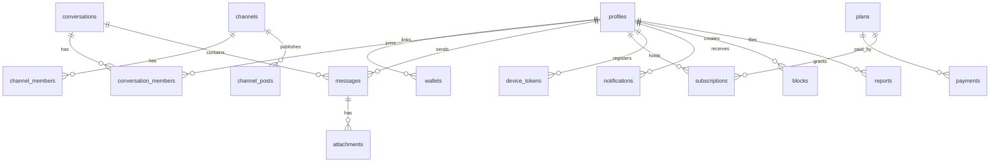

# EliteChat Database

Version 0.1 (draft) · Last updated 2026-10-13

The SQL below is a **design draft**. Review it, split it into migrations under `supabase/migrations/`, and cover it with pgTAP tests ([testing.md](testing.md)) before applying it to any shared environment.

## 1. Design rules

1. Every table in `public` has RLS enabled. A table with no policy is inaccessible to clients, which is the intended default for server-only tables.
2. Clients never receive wallet addresses of other users; `wallets` is readable only by its owner.
3. Multi-row or privileged operations (create DM, create group, change roles, join gated channel) are `security definer` RPC functions, not direct inserts.
4. Helper functions use `set search_path = ''` and schema-qualified names.
5. Token amounts are stored in base units as `numeric(78,0)` (large enough for a `uint256`).
6. Soft-delete messages (`deleted_at`) so realtime and moderation behave predictably.

## 2. Entity relationships



## 3. Types

```sql
create type public.conversation_type as enum ('direct', 'group');
create type public.member_role       as enum ('owner', 'admin', 'member');
create type public.message_kind      as enum ('text', 'image', 'file', 'system');
create type public.channel_role      as enum ('owner', 'admin', 'subscriber');
create type public.payment_status    as enum ('pending', 'confirmed', 'rejected');
create type public.subscription_status as enum ('active', 'expired', 'cancelled');
```

## 4. Identity tables

```sql
create table public.profiles (
  id           uuid primary key references auth.users(id) on delete cascade,
  handle       text unique check (handle ~ '^[a-z0-9_]{3,30}$'),
  display_name text check (char_length(display_name) between 1 and 60),
  avatar_path  text,
  bio          text check (char_length(bio) <= 280),
  created_at   timestamptz not null default now(),
  updated_at   timestamptz not null default now()
);

-- Wallet links. Written only by Edge Functions (service role).
create table public.wallets (
  id               uuid primary key default gen_random_uuid(),
  user_id          uuid not null references public.profiles(id) on delete cascade,
  chain_namespace  text not null check (chain_namespace in ('eip155', 'solana')),
  address          text not null,            -- normalized: lowercase for EVM
  is_primary       boolean not null default false,
  linked_at        timestamptz not null default now(),
  unique (chain_namespace, address)
);
create index wallets_user_idx on public.wallets (user_id);

-- Single-use sign-in nonces. Service role only (RLS on, no policies).
create table public.auth_nonces (
  nonce            text primary key,
  address          text not null,
  chain_namespace  text not null,
  domain           text not null,
  issued_at        timestamptz not null default now(),
  expires_at       timestamptz not null,
  used_at          timestamptz
);
create index auth_nonces_expires_idx on public.auth_nonces (expires_at);
```

## 5. Messaging tables

```sql
create table public.conversations (
  id              uuid primary key default gen_random_uuid(),
  type            public.conversation_type not null,
  title           text check (char_length(title) <= 100),
  avatar_path     text,
  direct_key      text unique,       -- 'uidA:uidB' (sorted) for direct chats; prevents duplicates
  created_by      uuid references public.profiles(id) on delete set null,
  last_message_at timestamptz,
  created_at      timestamptz not null default now(),
  check ((type = 'direct' and direct_key is not null) or type = 'group')
);

create table public.conversation_members (
  conversation_id uuid not null references public.conversations(id) on delete cascade,
  user_id         uuid not null references public.profiles(id) on delete cascade,
  role            public.member_role not null default 'member',
  joined_at       timestamptz not null default now(),
  last_read_at    timestamptz,
  muted_until     timestamptz,
  primary key (conversation_id, user_id)
);
create index conversation_members_user_idx on public.conversation_members (user_id);

create table public.messages (
  id              uuid primary key default gen_random_uuid(),  -- client may supply for idempotency
  conversation_id uuid not null references public.conversations(id) on delete cascade,
  sender_id       uuid references public.profiles(id) on delete set null,
  kind            public.message_kind not null default 'text',
  body            text check (char_length(body) <= 4000),
  reply_to        uuid references public.messages(id) on delete set null,
  created_at      timestamptz not null default now(),
  edited_at       timestamptz,
  deleted_at      timestamptz
);
create index messages_conv_created_idx
  on public.messages (conversation_id, created_at desc, id desc);

create table public.attachments (
  id              uuid primary key default gen_random_uuid(),
  conversation_id uuid not null references public.conversations(id) on delete cascade,
  message_id      uuid references public.messages(id) on delete cascade,
  uploader_id     uuid not null references public.profiles(id) on delete cascade,
  bucket          text not null,
  path            text not null,
  mime_type       text not null,
  size_bytes      bigint not null check (size_bytes > 0),
  width           int,
  height          int,
  created_at      timestamptz not null default now()
);
create index attachments_message_idx on public.attachments (message_id);
```

## 6. Channels

```sql
create table public.channels (
  id               uuid primary key default gen_random_uuid(),
  handle           text unique not null check (handle ~ '^[a-z0-9_]{3,30}$'),
  title            text not null check (char_length(title) between 1 and 100),
  description      text check (char_length(description) <= 500),
  avatar_path      text,
  owner_id         uuid references public.profiles(id) on delete set null,
  is_public        boolean not null default true,
  required_plan_id uuid,            -- FK added after plans table
  created_at       timestamptz not null default now()
);

create table public.channel_members (
  channel_id uuid not null references public.channels(id) on delete cascade,
  user_id    uuid not null references public.profiles(id) on delete cascade,
  role       public.channel_role not null default 'subscriber',
  joined_at  timestamptz not null default now(),
  primary key (channel_id, user_id)
);
create index channel_members_user_idx on public.channel_members (user_id);

create table public.channel_posts (
  id         uuid primary key default gen_random_uuid(),
  channel_id uuid not null references public.channels(id) on delete cascade,
  author_id  uuid references public.profiles(id) on delete set null,
  body       text not null check (char_length(body) <= 4000),
  created_at timestamptz not null default now(),
  deleted_at timestamptz
);
create index channel_posts_idx on public.channel_posts (channel_id, created_at desc, id desc);
```

## 7. Plans, payments, subscriptions

```sql
create table public.plans (
  id               uuid primary key default gen_random_uuid(),
  code             text unique not null,
  name             text not null,
  chain_id         bigint not null,
  token_address    text,                       -- null = native currency
  receiver_address text not null,
  price_amount     numeric(78,0) not null check (price_amount > 0),  -- base units
  duration_days    int not null check (duration_days > 0),
  is_active        boolean not null default true
);

alter table public.channels
  add constraint channels_required_plan_fk
  foreign key (required_plan_id) references public.plans(id) on delete set null;

-- Written only by the verify-payment Edge Function.
create table public.payments (
  id            uuid primary key default gen_random_uuid(),
  user_id       uuid not null references public.profiles(id) on delete cascade,
  plan_id       uuid not null references public.plans(id),
  chain_id      bigint not null,
  tx_hash       text not null,
  from_address  text not null,
  amount        numeric(78,0) not null,
  block_number  bigint,
  status        public.payment_status not null default 'pending',
  verified_at   timestamptz,
  created_at    timestamptz not null default now(),
  unique (chain_id, tx_hash)        -- a transaction can fund at most one entitlement
);
create index payments_user_idx on public.payments (user_id);

create table public.subscriptions (
  id         uuid primary key default gen_random_uuid(),
  user_id    uuid not null references public.profiles(id) on delete cascade,
  plan_id    uuid not null references public.plans(id),
  payment_id uuid not null references public.payments(id),
  status     public.subscription_status not null default 'active',
  starts_at  timestamptz not null,
  expires_at timestamptz not null,
  check (expires_at > starts_at)
);
create index subscriptions_user_idx on public.subscriptions (user_id, expires_at desc);
```

## 8. Supporting tables

```sql
create table public.device_tokens (
  id           uuid primary key default gen_random_uuid(),
  user_id      uuid not null references public.profiles(id) on delete cascade,
  token        text not null unique,
  platform     text not null check (platform in ('android', 'ios', 'web')),
  created_at   timestamptz not null default now(),
  last_seen_at timestamptz not null default now()
);

create table public.notifications (
  id         uuid primary key default gen_random_uuid(),
  user_id    uuid not null references public.profiles(id) on delete cascade,
  type       text not null,
  payload    jsonb not null default '{}',
  read_at    timestamptz,
  created_at timestamptz not null default now()
);
create index notifications_user_idx on public.notifications (user_id, created_at desc);

create table public.blocks (
  blocker_id uuid not null references public.profiles(id) on delete cascade,
  blocked_id uuid not null references public.profiles(id) on delete cascade,
  created_at timestamptz not null default now(),
  primary key (blocker_id, blocked_id),
  check (blocker_id <> blocked_id)
);

create table public.reports (
  id          uuid primary key default gen_random_uuid(),
  reporter_id uuid not null references public.profiles(id) on delete cascade,
  target_type text not null check (target_type in ('user', 'message', 'channel', 'conversation')),
  target_id   uuid not null,
  reason      text not null check (char_length(reason) <= 100),
  details     text check (char_length(details) <= 1000),
  status      text not null default 'open',
  created_at  timestamptz not null default now()
);
```

## 9. Helper functions

`security definer` helpers avoid infinite recursion when a policy on `conversation_members` needs to query `conversation_members`.

```sql
create or replace function public.is_conversation_member(_conversation_id uuid)
returns boolean
language sql stable security definer set search_path = ''
as $$
  select exists (
    select 1 from public.conversation_members m
    where m.conversation_id = _conversation_id
      and m.user_id = (select auth.uid())
  );
$$;

create or replace function public.has_conversation_role(
  _conversation_id uuid, _roles public.member_role[]
)
returns boolean
language sql stable security definer set search_path = ''
as $$
  select exists (
    select 1 from public.conversation_members m
    where m.conversation_id = _conversation_id
      and m.user_id = (select auth.uid())
      and m.role = any (_roles)
  );
$$;

create or replace function public.has_active_subscription(_plan_id uuid)
returns boolean
language sql stable security definer set search_path = ''
as $$
  select exists (
    select 1 from public.subscriptions s
    where s.user_id = (select auth.uid())
      and s.plan_id = _plan_id
      and s.status = 'active'
      and s.expires_at > now()
  );
$$;

revoke execute on function public.is_conversation_member(uuid)               from public, anon;
revoke execute on function public.has_conversation_role(uuid, public.member_role[]) from public, anon;
revoke execute on function public.has_active_subscription(uuid)              from public, anon;
grant  execute on function public.is_conversation_member(uuid)               to authenticated;
grant  execute on function public.has_conversation_role(uuid, public.member_role[]) to authenticated;
grant  execute on function public.has_active_subscription(uuid)              to authenticated;
```

## 10. RPC functions (privileged operations)

```sql
create or replace function public.create_direct_conversation(_other uuid)
returns uuid
language plpgsql security definer set search_path = ''
as $$
declare
  _me  uuid := (select auth.uid());
  _key text;
  _id  uuid;
begin
  if _me is null then raise exception 'not authenticated'; end if;
  if _other is null or _other = _me then raise exception 'invalid participant'; end if;
  if not exists (select 1 from public.profiles where id = _other) then
    raise exception 'user not found';
  end if;
  if exists (
    select 1 from public.blocks
    where (blocker_id = _me and blocked_id = _other)
       or (blocker_id = _other and blocked_id = _me)
  ) then
    raise exception 'not allowed';
  end if;

  _key := least(_me::text, _other::text) || ':' || greatest(_me::text, _other::text);

  insert into public.conversations (type, direct_key, created_by)
  values ('direct', _key, _me)
  on conflict (direct_key) do nothing
  returning id into _id;

  if _id is null then
    select id into _id from public.conversations where direct_key = _key;
    return _id;
  end if;

  insert into public.conversation_members (conversation_id, user_id)
  values (_id, _me), (_id, _other);
  return _id;
end;
$$;
revoke execute on function public.create_direct_conversation(uuid) from public, anon;
grant  execute on function public.create_direct_conversation(uuid) to authenticated;
```

Further RPCs to write (same pattern: validate caller, validate target, write inside one transaction): `create_group(title, member_ids[])`, `add_group_member`, `remove_group_member`, `set_member_role` (owner only), `leave_conversation`, `join_channel(channel_id)` (checks public status or `has_active_subscription(required_plan_id)`), `delete_my_account` helper used by the Edge Function.

## 11. Row Level Security

```sql
alter table public.profiles             enable row level security;
alter table public.wallets              enable row level security;
alter table public.auth_nonces          enable row level security;  -- no policies: service role only
alter table public.conversations        enable row level security;
alter table public.conversation_members enable row level security;
alter table public.messages             enable row level security;
alter table public.attachments          enable row level security;
alter table public.channels             enable row level security;
alter table public.channel_members      enable row level security;
alter table public.channel_posts        enable row level security;
alter table public.plans                enable row level security;
alter table public.payments             enable row level security;
alter table public.subscriptions        enable row level security;
alter table public.device_tokens        enable row level security;
alter table public.notifications        enable row level security;
alter table public.blocks               enable row level security;
alter table public.reports              enable row level security;
```

### Profiles and wallets

```sql
create policy profiles_select on public.profiles
  for select to authenticated using (true);

create policy profiles_update_own on public.profiles
  for update to authenticated
  using (id = (select auth.uid()))
  with check (id = (select auth.uid()));

create policy wallets_select_own on public.wallets
  for select to authenticated using (user_id = (select auth.uid()));
-- no insert/update/delete policies: Edge Functions only
```

### Conversations, members, messages

```sql
create policy conversations_select on public.conversations
  for select to authenticated using (public.is_conversation_member(id));

create policy conversations_update_admin on public.conversations
  for update to authenticated
  using (public.has_conversation_role(id, array['owner','admin']::public.member_role[]))
  with check (public.has_conversation_role(id, array['owner','admin']::public.member_role[]));
-- inserts happen through RPC functions

create policy members_select on public.conversation_members
  for select to authenticated using (public.is_conversation_member(conversation_id));

create policy members_update_own on public.conversation_members
  for update to authenticated
  using (user_id = (select auth.uid()))
  with check (user_id = (select auth.uid()));

-- Members may change only their own read/mute state, never role or membership.
revoke update on public.conversation_members from authenticated;
grant  update (last_read_at, muted_until) on public.conversation_members to authenticated;

create policy messages_select on public.messages
  for select to authenticated using (public.is_conversation_member(conversation_id));

create policy messages_insert on public.messages
  for insert to authenticated
  with check (
    sender_id = (select auth.uid())
    and public.is_conversation_member(conversation_id)
  );

create policy messages_update on public.messages
  for update to authenticated
  using (
    sender_id = (select auth.uid())
    or public.has_conversation_role(conversation_id, array['owner','admin']::public.member_role[])
  );

-- Only body/soft-delete may change; edited_at is set by trigger.
revoke update on public.messages from authenticated;
grant  update (body, deleted_at) on public.messages to authenticated;
```

> The update policy as written lets an admin edit another user's `body`. Tighten it (for example, admins may set only `deleted_at`, enforced by a trigger or by routing moderation through an RPC) before shipping.

### Attachments

```sql
create policy attachments_select on public.attachments
  for select to authenticated using (public.is_conversation_member(conversation_id));

create policy attachments_insert on public.attachments
  for insert to authenticated
  with check (
    uploader_id = (select auth.uid())
    and public.is_conversation_member(conversation_id)
  );
```

### Channels and posts

```sql
create policy channels_select on public.channels
  for select to authenticated using (
    (is_public and required_plan_id is null)
    or exists (select 1 from public.channel_members cm
               where cm.channel_id = id and cm.user_id = (select auth.uid()))
  );

create policy channel_members_select_own on public.channel_members
  for select to authenticated using (user_id = (select auth.uid()));
-- joins/role changes via RPC only

create policy channel_posts_select on public.channel_posts
  for select to authenticated using (
    exists (select 1 from public.channel_members cm
            where cm.channel_id = channel_posts.channel_id
              and cm.user_id = (select auth.uid()))
  );

create policy channel_posts_insert on public.channel_posts
  for insert to authenticated with check (
    author_id = (select auth.uid())
    and exists (select 1 from public.channel_members cm
                where cm.channel_id = channel_posts.channel_id
                  and cm.user_id = (select auth.uid())
                  and cm.role in ('owner', 'admin'))
  );
```

> `channel_posts_select` requires membership. If public channels should be previewable without joining, add a `public` clause consistent with `channels_select`. Subqueries on `channel_members` inside policies are fine because its own policy is simple; if recursion appears, move the checks into `security definer` helpers as in section 9.

### Plans, payments, subscriptions, personal data

```sql
create policy plans_select on public.plans
  for select to authenticated using (is_active);

create policy payments_select_own on public.payments
  for select to authenticated using (user_id = (select auth.uid()));

create policy subscriptions_select_own on public.subscriptions
  for select to authenticated using (user_id = (select auth.uid()));
-- payments and subscriptions are written only by the verify-payment Edge Function

create policy device_tokens_own on public.device_tokens
  for all to authenticated
  using (user_id = (select auth.uid()))
  with check (user_id = (select auth.uid()));

create policy notifications_select_own on public.notifications
  for select to authenticated using (user_id = (select auth.uid()));
create policy notifications_update_own on public.notifications
  for update to authenticated
  using (user_id = (select auth.uid()))
  with check (user_id = (select auth.uid()));
revoke update on public.notifications from authenticated;
grant  update (read_at) on public.notifications to authenticated;

create policy blocks_own on public.blocks
  for all to authenticated
  using (blocker_id = (select auth.uid()))
  with check (blocker_id = (select auth.uid()));

create policy reports_insert on public.reports
  for insert to authenticated with check (reporter_id = (select auth.uid()));
create policy reports_select_own on public.reports
  for select to authenticated using (reporter_id = (select auth.uid()));
```

## 12. Triggers

```sql
create or replace function public.touch_updated_at()
returns trigger language plpgsql set search_path = '' as $$
begin new.updated_at := now(); return new; end; $$;

create trigger profiles_touch before update on public.profiles
  for each row execute function public.touch_updated_at();

create or replace function public.on_message_insert()
returns trigger language plpgsql security definer set search_path = '' as $$
begin
  update public.conversations set last_message_at = new.created_at
  where id = new.conversation_id;
  return new;
end; $$;

create trigger messages_after_insert after insert on public.messages
  for each row execute function public.on_message_insert();

create or replace function public.on_message_edit()
returns trigger language plpgsql set search_path = '' as $$
begin
  if new.body is distinct from old.body then new.edited_at := now(); end if;
  return new;
end; $$;

create trigger messages_before_update before update on public.messages
  for each row execute function public.on_message_edit();
```

## 13. Realtime

```sql
alter publication supabase_realtime add table public.messages;
alter publication supabase_realtime add table public.conversation_members;
```

Realtime Postgres Changes evaluates RLS for inserts and updates, so clients only receive rows they can read. Verify this behavior, and the `DELETE` caveat (use soft deletes), against current Supabase documentation. **[VERIFY]**

## 14. Storage

| Bucket | Visibility | Path convention | Limits |
| --- | --- | --- | --- |
| `avatars` | Public read | `{user_id}/{uuid}.webp` | 2 MB, images only |
| `chat-attachments` | Private | `{conversation_id}/{uuid}` | Size and MIME allowlist set on the bucket (decide caps, for example 25 MB) |

```sql
create policy chat_attachments_read on storage.objects
  for select to authenticated
  using (
    bucket_id = 'chat-attachments'
    and public.is_conversation_member(((storage.foldername(name))[1])::uuid)
  );

create policy chat_attachments_insert on storage.objects
  for insert to authenticated
  with check (
    bucket_id = 'chat-attachments'
    and public.is_conversation_member(((storage.foldername(name))[1])::uuid)
  );

create policy avatars_write_own on storage.objects
  for insert to authenticated
  with check (
    bucket_id = 'avatars'
    and (storage.foldername(name))[1] = (select auth.uid())::text
  );
```

If the first path segment is not a valid UUID, the cast fails and the request is denied, which is acceptable fail-closed behavior. Deleting objects should happen through a function or Edge Function that also removes the `attachments` row.

## 15. Maintenance jobs

- Purge expired and used `auth_nonces` (hourly).
- Mark subscriptions `expired` when `expires_at` passes (daily, or compute at read time).
- Re-check `pending` payments until confirmed or rejected.
- Remove orphaned storage objects.

## 16. Migration conventions

- One logical change per file: `supabase/migrations/<timestamp>_<description>.sql`.
- Never edit an applied migration; add a new one.
- Every migration that adds a table must enable RLS in the same file.
- Each policy gets a pgTAP test for allowed and denied cases.
- Test migrations from scratch (`supabase db reset`) in CI.
