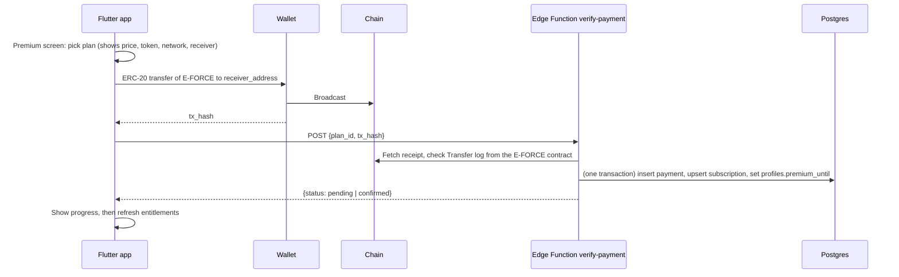

# EliteChat Premium (paid with $E-FORCE)

Version 0.1 (draft) · Last updated 2026-10-13

Covers: how users buy Premium with the **$E-FORCE** token, the Premium badge next to the name, name editing, the Premium feature system (how to add new features), what Premium and non-Premium users get, and all limits.

> **Update (v0.3):** Plans, global token prices, the Premium timer, and store distribution rules are now defined in [premium-access-and-plans.md](premium-access-and-plans.md). That file wins where the two differ. Premium is bought only with $E-FORCE (no Google Play Billing). Read section 2 of that file about Google Play and App Store rules before building the payment screens.

Read together with [web3-auth-and-payments.md](web3-auth-and-payments.md) (payment verification), [database.md](database.md) (schema), [security.md](security.md), and [admin-panel.md](admin-panel.md). Items marked **[DECIDE]** are product decisions. Items marked **[VERIFY]** must be confirmed before building. Items marked **[ALIGN]** must be matched with the existing doc once the schema is final.

---

## 1. Summary

| Topic | Decision |
| --- | --- |
| Payment | One-off period purchases in $E-FORCE (no recurring approvals) |
| Plans | 1 month, 3 months, 12 months (prices are placeholders, see section 5) |
| Premium badge | Small gold badge shown beside the display name everywhere the name appears |
| Name editing | Free users set their name once during onboarding; Premium users can edit it (with a cooldown) |
| Feature system | A `premium_features` registry table; one function decides every limit; server enforces, client only displays |
| Free tier | Core messaging is always free. Premium adds status, customization, and higher limits |
| Expiry | Badge and perks stop; data is never deleted; excess items become read-only |

**Principle: Premium sells status, convenience, and capacity. It never sells safety or basic access.** Reading messages, sending messages, blocking, reporting, push notifications, account deletion, data export, and (later) E2EE are always free.

---

## 2. Assumptions to confirm

1. $E-FORCE is an ERC-20 token on an EVM chain. **[VERIFY: chain, contract address, decimals]**
2. "Name edit" means the display name. The `@handle` is a separate identifier (section 6).
3. Free users cannot edit their name after onboarding. If you want free users to have one change, set `name_change_cooldown_days` for free to a large value instead of locking (section 6.3).
4. All numbers in the limits table are **proposals** and live in the database, so they can change without an app release.

---

## 3. Free vs Premium: feature matrix

| Area | Free | Premium |
| --- | --- | --- |
| **Identity** | | |
| Premium badge beside name | No | Yes (can be hidden in settings) |
| Display name edit | Set once at onboarding, then locked | Edit every 7 days |
| `@handle` change | Locked after first set | Once per 30 days (old handle held for 90 days) **[DECIDE]** |
| Bio length | 70 characters | 200 characters |
| Avatar upload size | 2 MB | 5 MB |
| **Messaging (core, always free)** | | |
| Direct chats | Unlimited | Unlimited |
| Realtime, read state, typing | Yes | Yes |
| Push notifications | Yes | Yes |
| Block and report | Yes | Yes |
| Message text length | 2,000 characters | 4,000 characters |
| **Media and storage** | | |
| Image attachment size | 5 MB | 15 MB |
| File attachment size (Phase 4) | 10 MB | 100 MB |
| Total attachment storage | 500 MB | 5 GB |
| **Chat organization** | | |
| Pinned chats | 3 | 10 |
| Chat folders / labels (later) | 2 | 10 |
| **Groups** | | |
| Groups you can join | 100 | 500 |
| Groups you can own | 3 | 20 |
| Members per group you own | 50 | 500 |
| Active invite links per group | 3 | 20 |
| **Channels** | | |
| Channels you can own | 1 | 10 |
| Create private / token-gated channels | No | Yes |
| Subscribers per channel you own | 500 | 5,000 |
| Join public channels and token-gated channels you qualify for | Yes | Yes |
| **Customization** | | |
| Dark / light theme | Yes | Yes |
| Extra accent colors and alternate app icons | No | Yes |
| **Convenience (later)** | | |
| Scheduled messages | No | Up to 20 pending |
| **Support and access** | | |
| Priority support queue | No | Yes |
| Early access to new features (opt-in) | No | Yes |

### What Premium never changes

- Moderation rules, rate limits against spam, and content policy apply equally. Premium does not bypass abuse controls.
- Premium does not give any access to other people's messages or data.
- Token-gated channels depend on the **gate token holdings** set by the channel owner, not on Premium.
- No ads for anyone.

---

## 4. Premium badge (the "logo beside the name")

### Rules

- The badge is **derived on the server** from `profiles.premium_until`. The client never sends or sets it.
- A user is Premium when `premium_until > now()`. Expiry needs no cleanup job: the check is time-based at read time.
- Users can turn the badge off in settings (`show_premium_badge`, default `true`). Perks stay active; only the visual is hidden. The badge shows that someone paid, so this is a reasonable privacy option.

### Where it appears

Chat list row, conversation header, sender name in groups and channels, member lists, search results, profile screen, and the user's own profile.

### Visual spec (proposal, replace after brand work)

| Item | Spec |
| --- | --- |
| Shape | Small bolt icon in a circle (ties to the E-FORCE name), `primary` gold on a dark chip |
| Size | 16 dp next to `titleMedium`, 14 dp next to `bodyMedium`, 20 dp on profile |
| Position | Immediately after the name, 4 dp gap, never truncated before the name |
| Semantics | Accessible label "Premium member" |
| Color | Uses the `primary` token; not color-only (the icon shape carries meaning) |
| Distinct from "verified" | Do not use a checkmark. If you add verified accounts later, use a different shape |

Add `PremiumBadge` and `NameWithBadge` widgets to `core/widgets` so every screen renders them the same way. Views never decide who is Premium; they read `isPremium` from the model.

### Anti-spoofing

- Display names cannot contain the badge glyph, bolt/star/crown emoji, or the words "premium", "official", "admin", "support", "EliteChat", "E-FORCE" (reserved list, section 6.2).
- The badge is a UI element drawn beside the name. It is never part of the stored name text, so a free user cannot fake it by typing symbols.

---

## 5. Plans and pricing in $E-FORCE

### Plan table (placeholders, **[DECIDE]** all amounts)

| Plan | Duration | Price (E-FORCE) | Note |
| --- | --- | --- | --- |
| `premium_1m` | 30 days | 500 | Base price |
| `premium_3m` | 90 days | 1,350 | 10% off |
| `premium_12m` | 365 days | 4,800 | 20% off |

### Rules

- Prices, token contract, chain, and receiver address come **only from the `plans` table**, never from the request.
- Store amounts in **base units** (integer). Example with 18 decimals: 500 E-FORCE = `500 * 10^18`. **[VERIFY decimals]**
- Fixed token amounts per plan for MVP. If the token price swings a lot, an admin adjusts plans (audit-logged). USD-pegged pricing with an oracle is a later option.
- One-off purchases only. No token approvals for recurring billing (high risk).
- Buying again while Premium extends from `max(now, premium_until)`, so users never lose paid time.
- Where the tokens go (treasury, burn, split) is a business and legal decision **[DECIDE]**; the receiver address in `plans` is the single source.
- Refund policy: on-chain payments are final. State this clearly before purchase. Manual refunds only through admin tooling with an audit entry **[DECIDE]**.

### Purchase flow

Uses the existing `verify-payment` flow in [web3-auth-and-payments.md](web3-auth-and-payments.md#8-subscription-payments). Premium-specific additions:



Verification must check every item in the existing checklist. The ones that matter most here:

- The log is emitted by the **expected E-FORCE contract address** (a fake token with the same name must fail).
- `to == receiver_address` and `value >= price_amount`.
- `from` is one of the caller's **linked wallets**.
- `(chain_id, tx_hash)` is unique, so one payment can only be claimed once.
- Grant Premium only at `confirmed`, after the required confirmations, and re-verify at confirmation time to handle reorgs.

### Purchase UX states

Matches [design.md](design.md#8-wallet-and-payment-ux):

`Choose plan` → `Waiting for wallet` → `Transaction submitted` → `Confirming (n/N)` → `Premium active`

- Can resume if the app is closed (pending payment is looked up on next launch).
- Wallet and RPC errors are mapped to friendly messages. Use the existing error codes (`payment_pending`, `payment_rejected`, `wallet_already_linked`, ...).
- Success screen shows the expiry date and a "Edit your name" shortcut.

### Expiry, renewal, and downgrade

| Moment | Behavior |
| --- | --- |
| 7 days before expiry | In-app reminder (and generic push) |
| Expiry | Badge disappears, free limits apply, premium-only actions are blocked |
| Name | Stays as it is. Only editing is locked again |
| Handle | Stays |
| Items over the free limit (groups owned, channels, pins, storage) | **Nothing is deleted.** Existing items keep working; the user just cannot create more until under the free limit. If a hard cap is technically needed, excess pins and folders are hidden, not removed |
| Members above a group's free cap | Existing members stay; no new members can join until the count drops below the cap |
| Private/token-gated channels | Stay available to existing members; the owner cannot create new ones |
| Re-subscribing | Everything is restored instantly |

This avoids data loss and avoids anger at expiry. **[DECIDE]** a grace period (for example 3 days) before limits re-apply.

---

## 6. Name editing

### 6.1 What can be edited

| Field | Free | Premium |
| --- | --- | --- |
| `display_name` (2–32 characters) | Once, during onboarding | Every 7 days |
| `handle` | Once, during onboarding | Once per 30 days **[DECIDE]** |

The wallet address is never a name and is not editable.

### 6.2 Validation (server side, in the RPC)

- Trim whitespace, collapse repeated spaces, length 2–32 after normalization.
- Unicode NFKC normalization; reject control characters, zero-width characters, and right-to-left override characters.
- Reject names that normalize to a **reserved** value (`admin`, `support`, `elitechat`, `e-force`, `official`, `moderator`, and so on) using a `reserved_names` table.
- Reject names that only differ from a reserved name by look-alike characters (confusables, mixed scripts such as Latin plus Cyrillic). Use a maintained confusables check **[VERIFY library]**.
- Allow Bengali and English letters, digits, spaces, and a small punctuation set.
- Handles: lowercase `a-z0-9_`, 3–20 characters, unique, case-insensitive.

### 6.3 Who may change it

Decided in one place, the `update_display_name` function (section 8):

1. Caller must be signed in.
2. If not Premium: allowed only if the name has never been set (`name_set_at is null`).
3. If Premium: allowed if `now() - name_changed_at >= name_change_cooldown_days` (feature value, default 7).
4. Write the change and a row in `name_change_log` in one transaction.

### 6.4 UI

- Premium: "Edit name" in Profile, with a notice "You can change your name again on <date>".
- Free: the Edit name row shows a lock and a "Premium" label; tapping opens the Premium screen (not a nag popup).
- Show a preview with the badge next to the name before saving.
- Name changes do not rewrite old messages; messages show the sender's current profile name.
- Moderators and admins can see the last N name changes (`name_change_log`) for abuse investigation and can force-reset a name.

---

## 7. Premium feature system (how features and limits work)

### 7.1 Design goals

- One source of truth for every limit: the `premium_features` table.
- Adding a new Premium feature needs a migration row, one enforcement point, and a UI lock state. No refactor.
- Limits can be tuned by an admin without shipping a new app.
- Enforcement is on the server. The client uses entitlements only to render locks and hints.

### 7.2 Feature registry

Each feature has a stable `key`.

| Column | Meaning |
| --- | --- |
| `key` | e.g. `groups_owned_max`, `name_edit`, `attachment_image_max_mb` |
| `kind` | `flag` (0/1) or `limit` (a number) |
| `free_value` | Value for free users. `-1` means unlimited |
| `premium_value` | Value for Premium users. `-1` means unlimited |
| `enabled` | If `false`, everyone gets the free value (feature switched off for Premium) |
| `description` | Human-readable explanation, used in admin tooling |

### 7.3 Initial registry (seed values match section 3)

| key | kind | free | premium |
| --- | --- | --- | --- |
| `badge` | flag | 0 | 1 |
| `name_edit` | flag | 0 | 1 |
| `name_change_cooldown_days` | limit | -1 (never) | 7 |
| `handle_change_cooldown_days` | limit | -1 | 30 |
| `bio_max_chars` | limit | 70 | 200 |
| `avatar_max_mb` | limit | 2 | 5 |
| `message_max_chars` | limit | 2000 | 4000 |
| `attachment_image_max_mb` | limit | 5 | 15 |
| `attachment_file_max_mb` | limit | 10 | 100 |
| `storage_quota_mb` | limit | 500 | 5000 |
| `pinned_chats_max` | limit | 3 | 10 |
| `folders_max` | limit | 2 | 10 |
| `groups_joined_max` | limit | 100 | 500 |
| `groups_owned_max` | limit | 3 | 20 |
| `group_members_max` | limit | 50 | 500 |
| `invite_links_active_max` | limit | 3 | 20 |
| `channels_owned_max` | limit | 1 | 10 |
| `channel_private_create` | flag | 0 | 1 |
| `channel_subscribers_max` | limit | 500 | 5000 |
| `accent_colors` | flag | 0 | 1 |
| `scheduled_messages_max` | limit | 0 | 20 |
| `priority_support` | flag | 0 | 1 |
| `early_access` | flag | 0 | 1 |

### 7.4 How features are enforced (pick the right layer)

| Type of limit | Enforced by | Example |
| --- | --- | --- |
| Row count | `before insert` trigger or RPC calling `feature_value` | `groups_owned_max`, `pinned_chats_max` |
| Field length | Check in RPC or trigger (plus a fixed absolute DB `check` as a hard upper bound) | `message_max_chars`, `bio_max_chars` |
| File size and storage quota | Storage policy plus an upload-registration RPC; quota counted from an `attachments` table | `attachment_*`, `storage_quota_mb` |
| Time cooldown | RPC reading `name_changed_at` | `name_change_cooldown_days` |
| Flag-gated action | RPC or RLS policy checking `feature_value(...) = 1` | `channel_private_create` |
| Pure UI cosmetic | Client reads entitlements (server also stores the choice only if Premium) | `accent_colors` |

Rule: if skipping the check would give someone unpaid capacity or break fairness, it must be enforced on the server. Client checks are UX only.

### 7.5 Client side

- `EntitlementRepository.fetchMine()` returns an `Entitlements` model (map of key → value, plus `isPremium` and `premiumUntil`).
- `EntitlementService` is an app-lifetime singleton registered in `InitialBinding`. It refreshes on app resume, after a confirmed payment, and when the profile row changes in realtime.
- Controllers receive it through the constructor, like any dependency. Views never call `Get.find`.
- Helper API (example): `ent.limit('groups_owned_max')`, `ent.has('channel_private_create')`.
- When the server rejects an action with `premium_required` or `limit_reached`, the controller maps it to a friendly message and the upgrade prompt.

### 7.6 Checklist: adding a new Premium feature

1. **Decide** the free and premium values and write them into section 3 and 7.3 of this doc.
2. **Migration:** insert a row into `premium_features` (new migration, never edit an applied one).
3. **Enforce on the server** using the matching layer in 7.4. Include `set search_path = ''` for any `security definer` function.
4. **Tests:** pgTAP allow and deny for free and Premium, plus the expiry boundary (just before and just after `premium_until`).
5. **Client:** read the value from `Entitlements`; add the locked state and the upgrade entry point; localize the new strings (en, bn).
6. **Admin panel:** make sure the new key shows up in the feature editor.
7. **Docs:** update this file and the PR checklist box "Docs updated".

### 7.7 Future: multiple tiers

The registry has two value columns now (free / premium). If a second tier is needed, change to a `tier_features (tier, key, value)` table and add `tier` to `plans` and `profiles.premium_tier`. Keep `feature_value` as the only function the rest of the code calls, so no call sites change.

---

## 8. Database draft (SQL)

Draft only. **[ALIGN]** with the final `plans`, `payments`, `subscriptions`, and `profiles` definitions in [database.md](database.md). All of this ships as reviewed migrations with RLS enabled in the same migration.

```sql
-- 8.1 Profile additions
alter table public.profiles
  add column premium_until timestamptz,
  add column show_premium_badge boolean not null default true,
  add column name_set_at timestamptz,
  add column name_changed_at timestamptz,
  add column handle_changed_at timestamptz;

-- Clients may only update safe columns. display_name, handle, premium_until,
-- and the timestamps above are NOT in this list; they change only via RPC/Edge Function.
revoke update on public.profiles from authenticated;
grant update (bio, avatar_url, show_premium_badge) on public.profiles to authenticated;
-- (bio length is validated by trigger against feature_value; see 8.4)

-- 8.2 Feature registry (read-only for clients)
create table public.premium_features (
  key           text primary key,
  kind          text not null check (kind in ('flag', 'limit')),
  free_value    bigint not null,
  premium_value bigint not null,
  enabled       boolean not null default true,
  description   text not null,
  updated_at    timestamptz not null default now()
);
alter table public.premium_features enable row level security;
-- Policy intent: any signed-in user may read limits (the app displays them).
create policy premium_features_read on public.premium_features
  for select to authenticated using (true);
-- No insert/update/delete policy: only migrations and the admin service change it.

-- 8.3 Core functions
create function public.is_premium(p_user uuid)
returns boolean
language sql stable security definer set search_path = ''
as $$
  select coalesce(
    (select p.premium_until > now() from public.profiles p where p.id = p_user),
    false);
$$;

create function public.feature_value(p_user uuid, p_key text)
returns bigint
language sql stable security definer set search_path = ''
as $$
  select case when f.enabled and public.is_premium(p_user)
              then f.premium_value
              else f.free_value end
  from public.premium_features f
  where f.key = p_key;
$$;

revoke all on function public.is_premium(uuid), public.feature_value(uuid, text)
  from public, anon;
grant execute on function public.is_premium(uuid), public.feature_value(uuid, text)
  to authenticated;

-- 8.4 Example enforcement: limit groups a user may own
create function public.enforce_groups_owned_limit()
returns trigger
language plpgsql security definer set search_path = ''
as $$
declare
  v_max bigint := public.feature_value(new.created_by, 'groups_owned_max');
  v_count bigint;
begin
  if new.type <> 'group' or v_max = -1 then
    return new;
  end if;
  select count(*) into v_count
  from public.conversations c
  where c.created_by = new.created_by and c.type = 'group';
  if v_count >= v_max then
    raise exception 'limit_reached:groups_owned_max' using errcode = 'P0001';
  end if;
  return new;
end;
$$;
-- create trigger ... before insert on public.conversations (when the group creation path is final)

-- 8.5 Name change RPC
create table public.reserved_names (
  name text primary key  -- stored normalized and lowercase
);
alter table public.reserved_names enable row level security;  -- no client policies

create table public.name_change_log (
  id          bigint generated always as identity primary key,
  user_id     uuid not null references public.profiles (id) on delete cascade,
  old_name    text,
  new_name    text not null,
  changed_at  timestamptz not null default now()
);
alter table public.name_change_log enable row level security;  -- admin/service only
create index on public.name_change_log (user_id, changed_at desc);

create function public.update_display_name(p_name text)
returns void
language plpgsql security definer set search_path = ''
as $$
declare
  v_uid      uuid := auth.uid();
  v_name     text := regexp_replace(btrim(p_name), '\s+', ' ', 'g');
  v_profile  public.profiles%rowtype;
  v_cooldown bigint;
begin
  if v_uid is null then
    raise exception 'not_authenticated' using errcode = '28000';
  end if;

  if char_length(v_name) not between 2 and 32 then
    raise exception 'invalid_name' using errcode = '22023';
  end if;

  -- Reserved names (extend with confusable/mixed-script checks in the Edge layer or here).
  if exists (select 1 from public.reserved_names r where r.name = lower(v_name)) then
    raise exception 'name_reserved' using errcode = '22023';
  end if;

  select * into v_profile from public.profiles where id = v_uid for update;

  if not public.is_premium(v_uid) then
    if v_profile.name_set_at is not null then
      raise exception 'premium_required' using errcode = 'P0001';
    end if;
  else
    v_cooldown := public.feature_value(v_uid, 'name_change_cooldown_days');
    if v_profile.name_changed_at is not null
       and v_cooldown >= 0
       and v_profile.name_changed_at > now() - make_interval(days => v_cooldown::int) then
      raise exception 'cooldown_active' using errcode = 'P0001';
    end if;
  end if;

  insert into public.name_change_log (user_id, old_name, new_name)
  values (v_uid, v_profile.display_name, v_name);

  update public.profiles
  set display_name   = v_name,
      name_set_at    = coalesce(name_set_at, now()),
      name_changed_at = now()
  where id = v_uid;
end;
$$;
revoke all on function public.update_display_name(text) from public, anon;
grant execute on function public.update_display_name(text) to authenticated;

-- 8.6 Granting Premium (called only by verify-payment / admin tooling with service_role)
create function public.grant_premium_period(p_user uuid, p_days int)
returns timestamptz
language plpgsql security definer set search_path = ''
as $$
declare
  v_new timestamptz;
begin
  update public.profiles
  set premium_until = greatest(now(), coalesce(premium_until, now()))
                      + make_interval(days => p_days)
  where id = p_user
  returning premium_until into v_new;
  return v_new;
end;
$$;
revoke all on function public.grant_premium_period(uuid, int) from public, anon, authenticated;
-- Only service_role (Edge Functions) can execute it.
```

Notes:

- The Edge Function must call `grant_premium_period` in the **same transaction** as the payment and subscription insert, or wrap the whole flow in one SQL function. A premium grant must never exist without a verified payment row.
- The badge for other users: other users' `profiles` rows are readable under existing profile policies, and `premium_until` is just a timestamp. If you prefer not to expose exact expiry dates to other users, expose a view with only `is_premium` (computed) and hide `premium_until` except for the owner. **[DECIDE]**
- Keep an absolute DB `check` as a hard upper bound on text lengths (for example `message_max_chars` never above 4,000) so a registry mistake cannot allow oversized rows.

---

## 9. Admin and support tooling

Matches the service-side rule in [admin-panel.md](admin-panel.md) **[ALIGN]**. Nothing here runs in the public client.

| Capability | Notes |
| --- | --- |
| View a user's Premium status, payments, and `name_change_log` | Read-only by default |
| Grant complimentary Premium (days) | Reason required; audit-logged |
| Revoke Premium (fraud, chargeback-equivalent, manual refund) | Reason required; audit-logged |
| Edit plans (price, duration, active) | Audit-logged; old payments keep their original terms |
| Edit `premium_features` values and `enabled` | Audit-logged; show impact warning ("changes limits for all users") |
| Force-reset a display name or handle | For impersonation and abuse |
| Manage `reserved_names` | |
| Manual payment review (wrong wallet, underpayment) | Matches the "support manual review" item in the web3 doc |

Admin roles: only a dedicated admin role (never `anon` or normal users), with two-person review for price and feature changes **[DECIDE]**.

---

## 10. UI and product behavior

### Screens

| Screen | Purpose |
| --- | --- |
| Premium (upsell) | Shows free vs Premium comparison (section 3), plans, price in E-FORCE, and "Connect wallet" if not connected |
| Plan checkout | Plan, price, token, network, receiver (shortened with copy), then wallet confirmation |
| Payment progress | The states in section 5, resumable |
| Premium status | Plan end date, "Extend", transaction history, badge visibility toggle |
| Edit name | Premium: editable with cooldown message. Free: locked state that links to Premium |

### Upsell rules (no dark patterns)

- Show the upgrade prompt only when the user taps a locked feature. No random popups, no countdown timers, no fake scarcity.
- Locked rows are visible with a lock icon and a one-line explanation, not hidden.
- Limits are explained when reached ("You've reached 3 groups on the free plan. Premium allows 20.") with a Dismiss button as prominent as the upgrade button.
- Do not claim features that do not exist yet. The comparison screen reads from `premium_features`, so it always matches the real limits.
- Copy stays plain: "Premium" and "E-FORCE", no price-speculation language or investment claims.

---

## 11. Security and abuse

| Risk | Mitigation |
| --- | --- |
| Client claims Premium | Premium is derived only from server-written `premium_until`; clients have no write access to it |
| Fake token with the same name | Verify the **contract address** emitted the `Transfer` log, not the token name |
| Someone claims another user's payment | `from` must be one of the caller's linked wallets; `(chain_id, tx_hash)` unique |
| Reorg or failed transaction after grant | Grant only at `confirmed`; re-verify at confirmation; admin can revoke |
| Price tampering | Price, token, and receiver are read from `plans` on the server |
| Name impersonation ("Admin", look-alike characters) | Reserved list, confusables check, forbidden badge glyphs, admin force-reset |
| Name-flipping abuse (changing name to scam people) | 7-day cooldown, `name_change_log`, report flow, and old names visible to moderators |
| Race conditions (two requests grant twice) | Single transaction, unique payment constraint, idempotent verify |
| Limit bypass via direct API calls | Limits enforced in triggers/RPCs, not only in the app |
| Data loss on expiry | No deletion on downgrade (section 5) |
| Privacy | Badge reveals only "paid", not the wallet; users can hide it. Logs never contain full wallet addresses, signatures, or message content |

---

## 12. Test cases

**Entitlements**

- Free user gets `free_value`; Premium user gets `premium_value`; `enabled = false` gives everyone the free value.
- At `premium_until - 1s` the user is Premium; at `premium_until + 1s` they are not.
- Clients cannot update `premium_until`, `display_name`, or `handle` directly (column grants).
- Clients cannot write `premium_features`, `name_change_log`, or `reserved_names`.

**Name editing**

- Free user sets a name at onboarding; the second change fails with `premium_required`.
- Premium user changes the name; an immediate second change fails with `cooldown_active`; it succeeds after the cooldown.
- Reserved and look-alike names are rejected; zero-width and RTL-override characters are rejected.
- Each change writes exactly one `name_change_log` row.
- After expiry, name editing locks again but the current name is unchanged.

**Limits (one pair of tests per key, free and Premium)**

- Creating the (limit + 1)th group, channel, pin, or invite link fails for free and succeeds for Premium up to its own limit.
- Oversized image and file uploads are rejected per tier; the storage quota counts correctly after deletes.
- Downgrade: existing items above the new limit stay usable; creating new ones is blocked.

**Payments (testnet, existing cases plus)**

- Correct E-FORCE payment sets `premium_until = now + plan duration`.
- Repeat purchase while active extends from the current expiry.
- Wrong token contract, wrong receiver, underpayment, failed transaction, and non-linked sender all rejected with no Premium granted.
- Same `tx_hash` submitted twice grants once.
- Simulated reorg before confirmation grants nothing.

**UI**

- Badge shows next to the name in every location listed in section 4 and respects `show_premium_badge`.
- Locked rows open the Premium screen; limit-reached messages appear in English and Bengali.
- Text scale 200% and screen reader labels ("Premium member") verified.

---

## 13. Where this fits in the roadmap

| Piece | Suggested phase |
| --- | --- |
| `premium_features`, `is_premium`, `feature_value`, `EntitlementService` scaffold (all values default to the free tier) | Phase 1 or 3, so limits are built in from the start instead of retrofitted |
| Name lock at onboarding (`name_set_at`), reserved names | Phase 2 (Profile creation) |
| Group/channel limits via `feature_value` | Phase 4 |
| Payment UI, `verify-payment`, `grant_premium_period`, expiry reminders | Phase 6 |
| Badge, name editing for Premium, admin tooling | Phase 6 |
| Independent review of payment and entitlement logic | Before enabling mainnet payments |

Note: MVP release (after Phase 3) can ship with the registry in place and Premium disabled, so no schema rework is needed when payments go live.

---

## 14. Open decisions

1. $E-FORCE chain, contract address, and decimals. **[VERIFY]**
2. Final plan prices and discounts.
3. Treasury, burn, or split of received tokens, and legal review of selling premium status for a token.
4. Refund policy and who can approve manual refunds.
5. Grace period after expiry (0 or 3 days).
6. Can free users change their name once, or never after onboarding?
7. Handle change rules for Premium (cooldown length, old handle reservation).
8. Expose exact `premium_until` to other users, or only a boolean?
9. Final numbers for every limit in section 7.3 after cost estimates (storage and realtime).
10. Single tier now, or plan for multiple tiers from day one?
11. Smart-contract wallet support for payments (same open item as the web3 doc).
