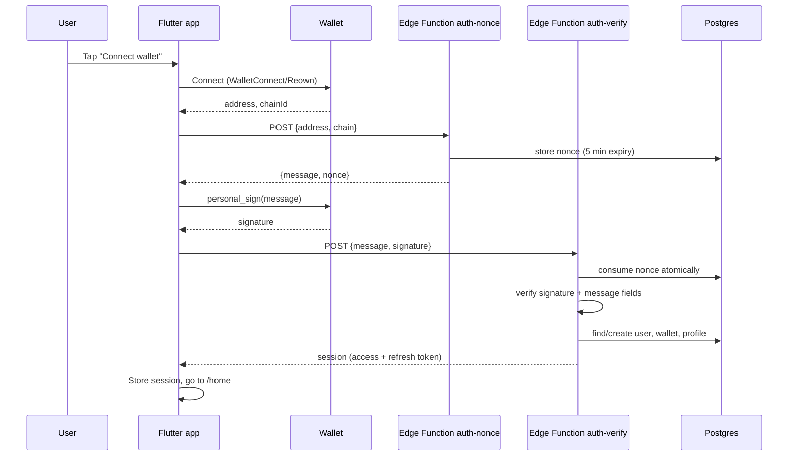
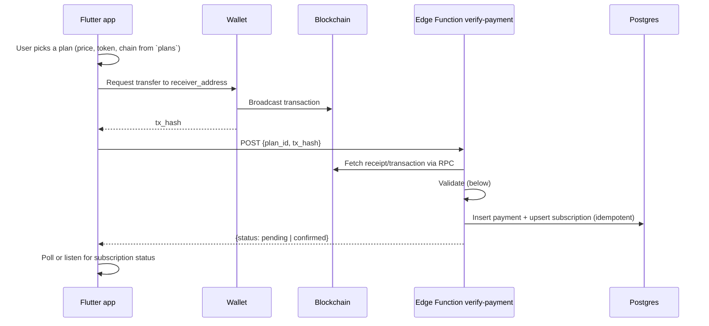

# Web3 Authentication and Payments

Version 0.1 (draft) · Last updated 2026-10-13

Covers wallet sign-in, session creation, wallet linking, and token-based subscription verification. Read [security.md](security.md) alongside this document. Items marked **[VERIFY]** must be confirmed against current documentation before implementation.

## 1. Scope and assumptions

- Identity is a wallet signature. There are no passwords.
- Initial target: EVM chains (CAIP-2 namespace `eip155`); Solana is possible later, the schema already allows it.
- The app never holds private keys or seed phrases. Signing happens in the user's wallet.
- Placeholders: domain `elitechat.app`, supported chain IDs to be decided.

## 2. Sign-in flow



## 3. Sign-in message

The server builds the message in [EIP-4361 (Sign-In with Ethereum)](https://eips.ethereum.org/EIPS/eip-4361) format so wallets can display it clearly and domain binding is explicit:

```
elitechat.app wants you to sign in with your Ethereum account:
0xAbC...EIP55-checksummed-address

Sign in to EliteChat. This does not send a transaction or cost any gas.

URI: https://elitechat.app
Version: 1
Chain ID: 1
Nonce: 4f9c2a7e1b6d8c03a5e2f7b9d1c4a860
Issued At: 2026-10-13T09:00:00Z
Expiration Time: 2026-10-13T09:05:00Z
```

The client displays the server-provided text unchanged and never constructs or edits it.

## 4. Edge Functions

### `auth-nonce`

| | |
| --- | --- |
| Auth | Public (no JWT) |
| Request | `{ "address": "0x...", "chain_namespace": "eip155", "chain_id": 1 }` |
| Response | `{ "message": "<SIWE text>", "nonce": "<hex>" }` |
| Server logic | Validate address format and chain against allowlist; rate limit by IP and address; generate ≥128-bit random nonce; insert into `auth_nonces` with `expires_at = now() + 5 min`; return the message |

### `auth-verify`

| | |
| --- | --- |
| Auth | Public (no JWT) |
| Request | `{ "message": "...", "signature": "0x..." }` |
| Response | `{ "session": { access_token, refresh_token, expires_in, ... } }` (shape depends on session approach, section 5) |

Verification steps, in order (fail closed on any mismatch, return one generic error to the client, log the specific reason server-side):

1. Parse the message; reject if any field is missing or malformed.
2. `domain` is in the allowlist; `uri` matches the allowed origin.
3. `chainId` is allowed.
4. `issuedAt` is not in the future (small clock skew allowed) and `expirationTime` has not passed.
5. **Atomically consume the nonce:** `update auth_nonces set used_at = now() where nonce = $1 and used_at is null and expires_at > now() and address = $2 returning *`. Zero rows means invalid, expired, or replayed.
6. Verify the signature:
   - EOA: recover the signer from the `personal_sign` signature and compare with `address` (case-normalized).
   - Smart-contract wallets: call `isValidSignature` (EIP-1271) through the RPC provider. Decide at launch whether to support them and whether to handle EIP-6492 for undeployed accounts; if not supported, return a clear message. **[VERIFY library support]**
7. Find the user by `(chain_namespace, address)` in `wallets`; if none, create the auth user, profile, and wallet row in one transaction.
8. Create and return a session (section 5).
9. Purge or ignore the nonce afterwards; never reuse.

Use a maintained library for SIWE parsing and signature verification rather than hand-written parsing or ECDSA code.

### `link-wallet` (authenticated)

Same verification, but requires a valid JWT and binds the verified address to the **caller's** user ID. Reject if the address is already linked to a different user. Require a fresh signature (not older than a few minutes) and limit the number of wallets per account.

### `verify-payment` (authenticated) — see section 8.

## 5. Session creation (biggest implementation risk)

Supabase Auth issues sessions for users it knows about; a wallet signature is not natively a Supabase credential unless Supabase supports it. Options:

| Option | Description | Pros | Cons |
| --- | --- | --- | --- |
| A. Native Supabase Web3 sign-in | Use Supabase Auth's built-in Ethereum/Solana sign-in if available for the target SDK | Least custom auth code; standard sessions and refresh | **[VERIFY]** whether `supabase_flutter` exposes it, whether you can control the statement/domain/nonce rules, and EIP-1271 support |
| B. Edge Function creates user and session via Admin API | `auth-verify` verifies the signature, then uses the service-role Admin API to create/find the user and obtain a real session | Full control over verification | **[VERIFY]** the supported Admin API path to mint a session with refresh token; avoid hacks that depend on side effects |
| C. Self-signed JWT | Edge Function signs its own JWT with the project JWT secret | Simple | Strongly discouraged: handling the JWT secret in functions raises blast radius, no refresh-token rotation or revocation |

**Recommendation:** run a 1–2 day spike on Option A first, then B. Do not choose C. Record the outcome in ADR-003.

Session requirements regardless of option: short access-token lifetime, refresh-token rotation, logout revokes the session, user-visible active sessions list.

## 6. Wallet linking and unlinking

- Adding a wallet requires being signed in plus a fresh signature from the new wallet.
- Removing a wallet requires a fresh signature from a *remaining* wallet; the last wallet cannot be removed without deleting the account.
- Changing the primary wallet requires a fresh signature.
- A wallet belongs to exactly one account (`unique (chain_namespace, address)`).
- Warn users: losing every linked wallet means losing the account (MVP).

## 7. Client integration notes

- Wrap the wallet package in `WalletService`; the rest of the app depends only on an interface (`connect`, `signMessage`, `disconnect`, `address`, `chainId`, `sendTransaction` for payments).
- `AuthController` orchestrates connect → request message → sign → verify, and exposes states: `idle`, `connecting`, `awaitingSignature`, `verifying`, `error`.
- Handle: user rejects the connection or signature, wallet app not installed, wallet returns on a different chain, app killed while in the wallet, relay disconnects, and a stale session proposal.
- App session and wallet connection are independent: signing out of the app should disconnect the wallet session; losing the wallet connection should not log the user out of chat, but payments require a live wallet connection.
- Web: test browser-extension wallets and QR/relay flows separately.

## 8. Subscription payments

### Flow



The client never decides entitlement. It only submits a hash and displays the server's result.

### Verification checklist (server side, fail closed)

1. The plan exists and is active; `chain_id`, token, receiver, and price come from the **database**, never from the request.
2. `tx_hash` is well-formed, and `(chain_id, tx_hash)` is not already used (the unique constraint is the final guard).
3. Receipt exists and `status` indicates success.
4. **Native payments:** `tx.to == receiver_address` and `tx.value >= price_amount`.
5. **ERC-20 payments:** the receipt contains a `Transfer(address,address,uint256)` log (topic0 `0xddf252ad1be2c89b69c2b068fc378daa952ba7f163c4a11628f55a4df523b3ef`) emitted by the **expected token contract**, with `to == receiver_address` and `value >= price_amount`.
6. The transfer sender (`from`) equals one of the **caller's linked wallet addresses**. This prevents someone else claiming another user's payment hash.
7. Confirmations: require at least N blocks (or chain-appropriate finality) before marking `confirmed`; otherwise store `pending` and let a scheduled job re-check.
8. Re-verify the receipt at confirmation time to handle reorgs; if the transaction disappears, set `rejected` and do not grant access.
9. Insert `payments` and `subscriptions` in one database transaction. Repeating the same request returns the existing result.
10. Subscriptions extend from `max(now, current expires_at)` when the user already has an active period for the same plan.

### Things to decide

- Supported chains and tokens (stablecoins reduce price volatility; note decimals differ per token, always store base units).
- Confirmation thresholds per chain.
- Refund and cancellation policy; there is no automatic chargeback on-chain.
- Handling of overpayment, underpayment, and payments from a non-linked wallet (recommended: reject with guidance, support manual review).
- Whether to use recurring approvals; **recommended against for MVP** because token approvals are high risk. Use one-off period purchases.
- Tax and regulatory treatment of crypto payments for your jurisdiction (consult an advisor).

### RPC provider

- Keys live only in Edge Function secrets; never in the client.
- Use a reputable provider; add a secondary provider for high-value verification; set timeouts and fail closed.

## 9. Error codes (server to client)

| Code | Meaning | UI behavior |
| --- | --- | --- |
| `invalid_request` | Malformed input | Generic error |
| `nonce_invalid` | Expired, used, or unknown nonce | "That request expired. Try again." and restart flow |
| `signature_invalid` | Signature/address mismatch | "Couldn't verify your wallet." |
| `unsupported_chain` | Chain not allowed | Prompt to switch network |
| `wallet_already_linked` | Address bound to another account | Explain and offer support link |
| `rate_limited` | Too many attempts | Show wait time |
| `payment_pending` | Awaiting confirmations | Show progress |
| `payment_rejected` | Verification failed | Explain next steps, no technical details |

Specific internal reasons are logged server-side only.

## 10. Test cases

**Sign-in**

- Valid EOA signature succeeds and creates user, profile, wallet.
- Replayed signature fails (nonce already used).
- Two concurrent verifies with the same nonce: exactly one succeeds.
- Expired nonce fails; nonce issued for address A used with address B fails.
- Wrong domain, wrong URI, wrong chain ID, tampered statement, or modified address all fail.
- Signature from a different key fails.
- Smart-contract wallet behaves as documented (supported or cleanly rejected).
- Rate limiting triggers on repeated nonce requests.

**Linking**

- Cannot link an address already owned by another user.
- Cannot unlink the last wallet.
- Stale signature rejected.

**Payments (run on a testnet)**

- Correct native and ERC-20 payments succeed.
- Wrong token contract, wrong receiver, underpayment, failed transaction, wrong chain all rejected.
- Same tx hash submitted by two users: only the owner of the sending wallet succeeds, and only once.
- Pending transaction confirms later via the scheduled job.
- Simulated reorg removes the transaction before confirmation: entitlement not granted.
- Idempotent retry returns the same result.
- Subscription extension math across expiry boundaries.

## 11. Open decisions

1. EVM-only launch, or EVM + Solana?
2. Session minting option (A or B) after the spike.
3. Smart-contract wallet support at launch.
4. Wallet package choice and confirmed Web support.
5. Supported tokens, chains, and confirmation thresholds.
6. Account recovery strategy post-MVP.
